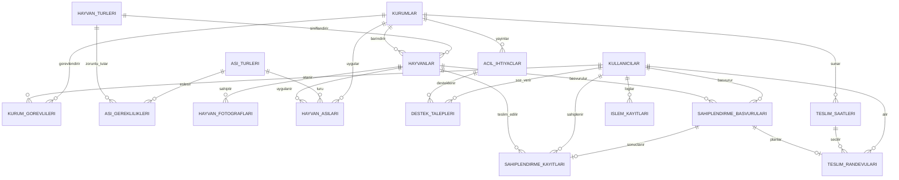

# PatiPortal Veritabanı ER Diyagramı (16 Tablo)

## Tablo Özeti
1. `kullanicilar` — Ziyaretçi, görevli ve admin hesapları (telefon Fernet ile şifreli).
2. `kurumlar` — Barınak ve veteriner klinikleri.
3. `kurum_gorevlileri` — Görevlilerin yetkili olduğu kurum eşleştirmesi (N:M).
4. `hayvan_turleri` — Kedi, Köpek vb. tür tanımları.
5. `hayvanlar` — Hayvan kartları, durum (`barinakta`/`tedavide`/`sahiplendirildi`) ve kurum bağı.
6. `hayvan_fotograflari` — WEBP büyük/küçük dosya yolları ve kapak seçimi.
7. `asi_turleri` — Karma, Kuduz, Parazit vb. aşı tanımları.
8. `asi_gerekliligi` — Hayvan türüne göre zorunlu aşı listesi.
9. `hayvan_asilari` — Hayvan aşı karnesi, sonraki doz tarihi ve belge yolu.
10. `acil_ihtiyaclar` — Kurumların mama/ilaç/malzeme ihtiyaçları.
11. `destek_talepleri` — Ziyaretçi/kullanıcı destek sözleri (telefon şifreli).
12. `sahiplendirme_basvurulari` — Başvurular (`uq_bekleyen_basvuru` kısmi tekillik kısıtlı).
13. `teslim_saatleri` — Kurumların teslim randevu saat dilimleri.
14. `teslim_randevulari` — Onaylı başvuruların teslim randevuları (`basvuru_id` tekil).
15. `sahiplendirme_kayitlari` — Tamamlanan teslim kayıtları (`basvuru_id` tekil).
16. `islem_kayitlari` — Tüm kritik işlemlerin denetim (audit) logları.